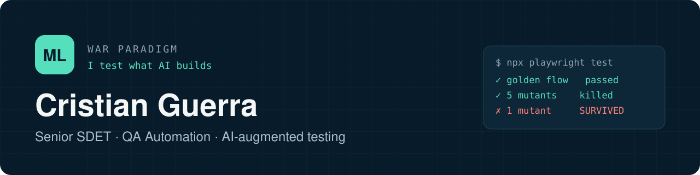

  

  
  
  

## About

Senior SDET with 7+ years in test automation, mostly in fintech and banking. I design automation frameworks from zero, test APIs and web apps end to end, and put quality gates into CI.

Lately most of my work is **testing what AI builds**: making verdicts measurable when outputs are not deterministic, and using AI assistants to design and explore tests faster while a person still signs off.

## Featured work

| Project | What it shows | Stack |
|---|---|---|
| **[mutant-lab](https://github.com/criguex/mutant-lab)** | Runnable experiments behind my posts: mutant scenarios, scoring AI output against acceptance criteria, a second brain for AI-assisted QA | Playwright · TypeScript · CI |
| **[civica-playwright-challenge](https://github.com/criguex/civica-playwright-challenge)** | Production-shaped framework: Page Object Model, semantic locators, deterministic mock layer, accessibility checks, self-learning mutant scenarios | Playwright · TypeScript · GitHub Actions |
| **[playwright-saucedemo-e2e](https://github.com/criguex/playwright-saucedemo-e2e)** | Cross-browser E2E suite with POM and CI on every push | Playwright · TypeScript |
| **[karate-api-testing](https://github.com/criguex/karate-api-testing)** | Data-driven REST API testing with happy and failure paths | Karate DSL · Java · Maven |
| **[serenity-screenplay-salesforce](https://github.com/criguex/serenity-screenplay-salesforce)** | Screenplay pattern for business web flows with living documentation | Serenity BDD · Java · Cucumber |
| **[selenium-cucumber-pom](https://github.com/criguex/selenium-cucumber-pom)** | Classic layered web framework: drivers, hooks, page objects, test data | Selenium · Java 17 · Cucumber |

## How I work

- **Golden flows first, then mutate them.** One change per mutant; if the suite stays green, that's a finding.
- **API first, UI for evidence.** Fast, stable checks at the service layer; the browser proves the user journey.
- **Deterministic verdicts for non-deterministic systems.** Pass/fail where the spec allows it, scores against acceptance criteria where it doesn't, and the same input run 3 times.
- **Hard rules live in code, not in prompts.** Hooks, CI gates and reviews that can't be forgotten.

## Toolbox

**Web & mobile:** Playwright · Selenium · Cypress · Serenity BDD (Screenplay) · Appium
**API & performance:** Karate DSL · REST Assured · Postman · k6 · JMeter
**Languages:** TypeScript · JavaScript · Java · SQL
**CI & infra:** GitHub Actions · GitLab CI · Jenkins · Docker
**Practices:** BDD (Cucumber/Gherkin) · contract testing · test management with Jira/Xray · AI-assisted testing (Claude Code, Copilot, MCP)

## Contact

The best way to reach me is [LinkedIn](https://www.linkedin.com/in/criguex). Open to remote contract roles in QA automation and SDET.
